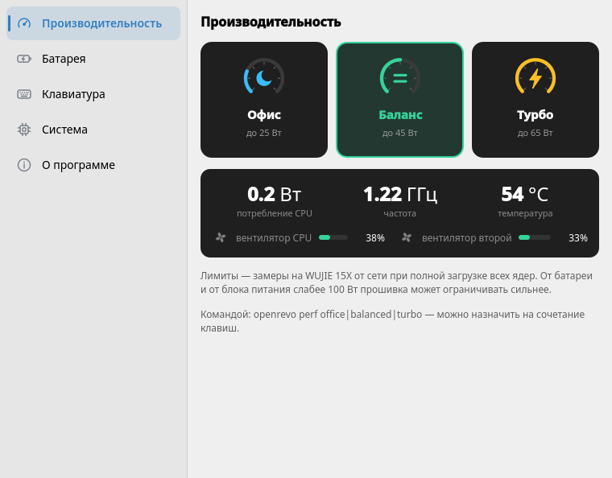
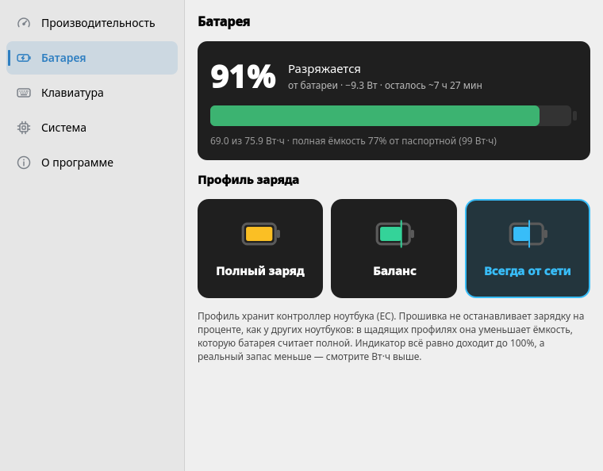
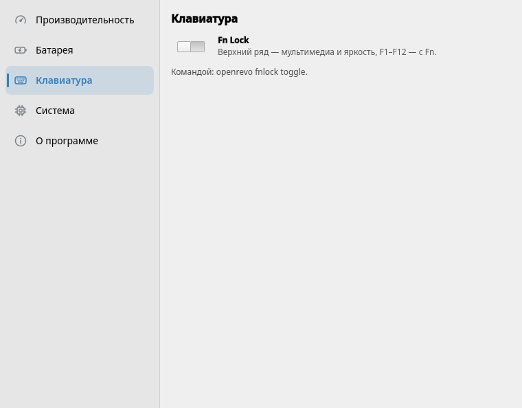

# Open Revo для Linux

Режимы производительности, профиль заряда батареи и Fn Lock для ноутбуков MECHREVO на
платформе Uniwill / TongFang — то, что в Windows делает фирменный ControlCenter.
Rust + Qt 6 / QML, по образцу [micontrol-linux](https://github.com/AbyssMoon/micontrol-linux).

*Performance modes, battery charging profile and Fn Lock for MECHREVO (Uniwill / TongFang)
laptops on Linux. Rust + Qt 6.*

| Производительность | Батарея | Клавиатура |
|---|---|---|
|  |  |  |

## Возможности

- **Режимы производительности** «Офис», «Баланс», «Турбо» — те же, что в ControlCenter.
  На WUJIE 15X от сети CPU получает 25, 45 и 65 Вт (первые ~50 секунд — 30, 50 и 70 Вт).
  Режим сохраняется и восстанавливается после загрузки и сна.
- **Профиль заряда**: полный заряд, баланс, «всегда от сети» — бережёт батарею, если ноутбук
  почти не отключают от зарядки.
- **Fn Lock**.
- **Мониторинг**: потребление, частота и температура CPU, вентиляторы, заряд и износ батареи.
- **Значок в трее**: режим и состояние в подсказке, переключение по правому клику.
- **Команда `openrevo`** — всё то же из терминала; удобно вешать на сочетания клавиш.

## Проверенные модели

| Модель | Плата | BIOS | Статус |
|---|---|---|---|
| MECHREVO WUJIE 15X (无界15X, Ryzen 7 8845HS) | WUJIE15-GX5HRXG | N.1.14MRO50 | всё работает¹ |

¹ Режимы проверены от сети (USB-C PD 100 Вт); от батареи — нет. Как именно прошивка
ограничивает заряд в разных профилях, ещё выясняется — см. [docs/HARDWARE.md](docs/HARDWARE.md).

Другие MECHREVO и ноутбуки TongFang с WMI Uniwill, скорее всего, тоже подойдут: профиль
заряда и Fn Lock работают на любой плате, которую понимает tuxedo-drivers, а для режимов
плату нужно добавить в патч драйвера. См. [«Проверка своей модели»](#проверка-своей-модели).

## Как это работает

Управление идёт через [tuxedo-drivers](https://gitlab.com/tuxedocomputers/development/packages/tuxedo-drivers)
(TUXEDO продаёт ноутбуки на тех же платформах) с двумя патчами: пропустить MECHREVO через
проверку производителя и включить для платы WUJIE 15X то, что драйвер включает для
TUXEDO InfinityBook Pro Gen9 AMD. Пакет ставит из него только нужные модули и собирает их
через DKMS под каждое новое ядро.

Подробности — регистры EC, ioctl, замеры — в [docs/HARDWARE.md](docs/HARDWARE.md).

## Установка

Готовые файлы — на странице [Releases](https://github.com/AbyssMoon/open-revo-linux/releases/latest).
Пакеты ставят демон, который запускается при старте системы, значок в трее при входе в сеанс
и драйвер, который DKMS пересобирает под каждое новое ядро.

> Если стоят `tuxedo-drivers`, `tuxedo-drivers-dkms` или `mechrevo-drivers-dkms`, удалите их:
> они ставят модули с теми же именами.

**Fedora 44+** (`openrevo-<версия>-1.fc44.x86_64.rpm`):

```sh
sudo dnf install ./openrevo-*.rpm      # подтянет dkms и kernel-devel
sudo dnf remove openrevo               # удалить (настройки в /var/lib/openrevo остаются)
```

**Ubuntu 24.04+, Debian 13+, Linux Mint 22+** (`openrevo_<версия>_amd64.deb`):

```sh
sudo apt install ./openrevo_*_amd64.deb   # подтянет dkms и заголовки ядра
sudo apt remove openrevo                  # удалить; apt purge — вместе с настройками
```

**Другие дистрибутивы** — переносная сборка, в систему ничего не ставит:

```sh
tar xf openrevo-portable.tar.xz && cd openrevo-portable
./build-driver.sh      # один раз после каждого обновления ядра
./run.sh probe         # только чтение: проверить, что драйвер видит ноутбук
./run.sh               # демон (sudo) + окно; выход — через меню в трее
./run.sh --mock        # интерфейс без железа и без root
```

После установки пакета: окно — «Open Revo» в меню приложений, CLI — `openrevo status`,
лог демона — `journalctl -u openrevod`.

### Secure Boot

С включённым Secure Boot модули загрузятся, только если подписаны ключом из MOK.
DKMS подписывает их сам, но ключ нужно один раз внести в прошивку:

```sh
# Ubuntu / Debian (при установке DKMS может сам предложить это и спросить пароль)
sudo mokutil --import /var/lib/shim-signed/mok/MOK.der
# Fedora
sudo mokutil --import /var/lib/dkms/mok.pub
```

Задайте одноразовый пароль, перезагрузитесь, на синем экране MOK Manager выберите
«Enroll MOK» и введите его. Проверка: `ls /dev/tuxedo_io`.

### Что ставят пакеты

`/opt/openrevo` (программа со встроенным Qt 6), `openrevod.service`,
`/usr/src/openrevo-drivers-*` для DKMS, `/usr/lib/modules-load.d/openrevo.conf`,
`/usr/lib/modprobe.d/openrevo.conf` (чёрный список `uniwill_laptop`), ярлык в меню,
автозапуск `/etc/xdg/autostart/openrevo.desktop` (`openrevo-gui --tray`), команды `openrevo` и
`openrevo-gui`.

## Командная строка

```sh
openrevo status
openrevo perf office|balanced|turbo
openrevo charge high_capacity|balanced|stationary
openrevo fnlock on|off|toggle
sudo openrevo probe          # без демона, только чтение
```

## Сборка из исходников

Тулчейн ставится в `.toolchain/` внутри проекта (Rust через rustup, Qt 6.8.3 через aqtinstall).
Нужны `curl`, `python3`, `gcc`/`g++`, `make` и системная `libGL`.

```sh
./scripts/setup-toolchain.sh
source env.sh
cargo build --workspace
cargo test --workspace

./scripts/build-driver.sh       # → build/driver/*.ko под текущее ядро
./scripts/make-portable.sh      # → dist/openrevo-portable и .tar.xz
./scripts/make-rpm.sh           # → dist/openrevo-*.rpm (нужен rpmbuild)
./scripts/make-deb.sh           # → dist/openrevo_*_amd64.deb (нужен dpkg-deb)
```

Если `download.qt.io` недоступен, у Qt есть зеркала, но aqtinstall сверяет контрольные суммы
только с ним. Для разработки хватит системного Qt 6 — `env.sh` подхватит его сам, если Qt нет
в `.toolchain/`:

```sh
sudo dnf install qt6-qtbase-devel qt6-qtdeclarative-devel        # Fedora
sudo apt install qt6-base-dev qt6-declarative-dev                 # Ubuntu / Debian
```

Пакеты и переносная сборка собираются только со своим Qt (это делает CI).

Разработка без ноутбука MECHREVO:

```sh
export OPENREVO_SOCKET=$XDG_RUNTIME_DIR/openrevo-dev.sock
./target/debug/openrevod --mock --socket $OPENREVO_SOCKET --state /tmp/or-state.json &
./target/debug/openrevo-gui
```

## Проверка своей модели

```sh
./scripts/build-driver.sh
sudo insmod build/driver/tuxedo_compatibility_check/tuxedo_compatibility_check.ko
sudo modprobe -a led_class_multicolor sparse_keymap
sudo insmod build/driver/tuxedo_keyboard.ko
sudo insmod build/driver/uniwill_wmi.ko
sudo insmod build/driver/tuxedo_io/tuxedo_io.ko
cargo build -p openrevo-cli && sudo ./target/debug/openrevo probe   # только чтение
```

Откройте issue с выводом `probe` и `cat /sys/class/dmi/id/{sys_vendor,product_name,board_name,bios_version}`.
Если `probe` пишет «режимов в драйвере: 0», плату нужно добавить в
`third_party/tuxedo-drivers/patches/0002-wujie15x-board.patch` — рядом с платой TUXEDO
на той же платформе (её можно узнать по имени вида `GXxHRXx` в `uniwill_keyboard.h`).

## Устройство

- `crates/openrevo-core` — значения прошивки, доступ к `/dev/tuxedo_io` и sysfs, эмуляция, IPC.
- `crates/openrevod` — демон (root): переключение, сохранение и восстановление настроек.
- `crates/openrevo-cli` — `openrevo`: клиент демона и `probe` для проверки драйвера.
- `crates/openrevo-gui` — интерфейс на QML (cxx-qt) со значком в трее.
- `third_party/tuxedo-drivers` — нужная часть tuxedo-drivers с патчами; обновляется
  `scripts/update-driver.sh`.

## Документация

- [docs/DEVELOPMENT.md](docs/DEVELOPMENT.md) — архитектура, IPC, отладка, драйвер, релиз.
- [docs/HARDWARE.md](docs/HARDWARE.md) — драйвер, регистры EC, замеры, открытые вопросы.
- [CONTRIBUTING.md](CONTRIBUTING.md) — как проверить свою модель и прислать данные.

## Благодарности

- [tuxedo-drivers](https://gitlab.com/tuxedocomputers/development/packages/tuxedo-drivers) — © TUXEDO Computers, GPL v2.
- Патч проверки производителя — из AUR [mechrevo-drivers-dkms](https://aur.archlinux.org/packages/mechrevo-drivers-dkms).
- Заводские лимиты режимов WUJIE 15X — из [OpenRevo](https://github.com/faintonce/open-revo) для Windows.

## Лицензия

GNU GPL v3 или новее. `third_party/tuxedo-drivers` — GNU GPL v2, © TUXEDO Computers.

Проект не связан с MECHREVO, TongFang и TUXEDO. Используйте на свой страх и риск.
